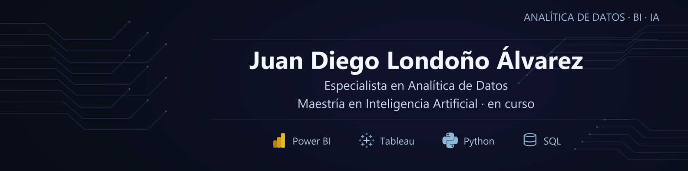
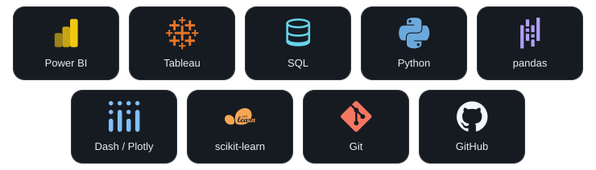

  

  

  
  
  

## Sobre mí

Soy **ingeniero industrial** y **especialista en Analítica de Datos Aplicada a los Negocios**. Actualmente curso la **Maestría en Inteligencia Artificial en la Universidad de La Salle**.

Mi portafolio reúne proyectos académicos de análisis, visualización y modelado. Me interesa conectar los problemas de negocio y los datos públicos con soluciones que pueda construir, explicar y mejorar.

| Enfoque | Lo que desarrollo y estudio |
| --- | --- |
| **Analítica y visualización** | Preparación de datos, análisis exploratorio y dashboards para comunicar resultados. |
| **Modelos aplicados** | Pronóstico de ventas, comparación de modelos y evaluación de sus errores. |
| **Inteligencia artificial** | Fundamentos de programación y aprendizaje automático, con práctica progresiva. |
| **Investigación** | Anteproyecto sobre patrones atípicos en contratación pública con datos de SECOP II, actualmente en preparación. |

## Herramientas

  

## Proyecto destacado · Mortalidad en Colombia

Dashboard interactivo para explorar datos agregados del DANE de 2019, con siete visualizaciones y filtros por departamento.

**Python · pandas · Dash · Plotly**

[Explorar el código y la documentación](https://github.com/Juandi051400/mortalidad-colombia-2019) · [Abrir la aplicación](https://mortalidad-colombia-2019-rqso.onrender.com/)

## Otros proyectos

| Proyecto | Problema y aporte | Alcance actual |
| --- | --- | --- |
| [**Pronóstico de ventas en el sector textil**](https://github.com/Juandi051400/pronostico-ventas-sector-textil) | Caso académico en coautoría: preparación de datos y comparación de modelos de pronóstico siguiendo CRISP-DM. | Ficha del trabajo de grado de especialización de 2023. Documentación pública; los datos comerciales y cuadernos originales no están incluidos. |

## Lo que quiero seguir construyendo

- Análisis con datos públicos y decisiones documentadas.
- Aplicaciones que permitan explorar y comprender los resultados.
- Experimentos de IA comparables y reproducibles, empezando por modelos sencillos.

  <b>Aprender, construir y explicar lo que hago.</b> 
  Colombia · Español · <a href="https://www.linkedin.com/in/juan-diego-londo%C3%B1o-%C3%A1lvarez-6a70811ab/">Conversemos en LinkedIn</a>

<!-- Presentación visual inspirada en github.com/jmmana. Texto y portada adaptados al trabajo de Juan Diego; no se reutilizan credenciales ni resultados de terceros. -->
